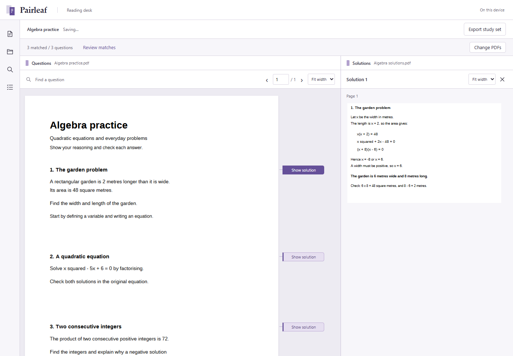

# Pairleaf

Keep the question in view. Open its original solution beside it.

Pairleaf is a Chrome extension for studying from PDF question papers and textbooks. Open a question-and-solution pair, or one PDF with answers at the back. Save your study sets locally and pick up where you left off.

_The screenshot uses invented practice material._

## What it does

- Links numbered questions to existing solutions using question numbers and chapter or exercise context.
- Reveals original solution pages beside the question, including answers that continue across pages.
- Detects a textbook's answer section and lets you correct its page range.
- Lets you preview and correct detected matches.
- Keeps your PDFs in their folders and saves match choices, reading position, and zoom in a local study library.
- Exports and imports complete study sets as `.pairleaf` backups.

Reading and matching work offline. No account, API key, or helper process is needed.

## Install a packaged build

The public release and Chrome Web Store listing are being prepared. A packaged build can be installed in Chrome without terminal commands:

1. Extract `Pairleaf-<version>.zip` into a folder you will keep.
2. Open `chrome://extensions` and turn on **Developer mode**.
3. Choose **Load unpacked** and select the extracted folder containing `manifest.json`.
4. Open **Pairleaf** from Chrome's Extensions menu. Pin it for quick access.

The extension ZIP is different from the source ZIP. A source checkout needs the [development build steps](docs/DEVELOPMENT.md#build-and-run).

To update an unpacked installation, export your study sets first, replace the contents of the same installed folder, then click **Reload** on its extension card. Open a fresh Pairleaf tab. Keep that folder in place while the extension is installed.

## Start a study set

**Separate PDFs:** select or drop the question PDF and its solutions PDF, then choose **Pair PDFs**.

**Answers in this PDF:** select the textbook and choose **Open PDF**. Confirm the detected answer pages, or enter the first and last pages yourself. Use PDF page numbers, which may differ from the printed numbers. Preview the boundary pages if needed, then choose **Use pages**. You can correct the range later with **Answer pages**.

Your original PDFs stay in their folders. Reopen a study from **Library**; Chrome may ask for file access again. Use **Locate files** if a PDF has moved or access has expired. Pairleaf checks the file contents before restoring progress. Changed PDFs need a new study.

**Export study set** saves a complete `.pairleaf` backup containing the PDFs and progress. An imported study uses that backup file, so keep it in place. Later progress stays in Chrome until you export again. Export before clearing extension data or switching installations. Older saved PDF copies can be replaced with verified file links using **Locate files**.

[Supported PDFs](docs/SUPPORTED_PDFS.md) · [Privacy](https://pairleaf-privacy.swoony-bean-3091.chatgpt.site/) · [Development](docs/DEVELOPMENT.md) · [Release notes](CHANGELOG.md) · [Report an issue](https://github.com/kkallam08/pairleaf/issues)

When reporting a document problem, describe the layout and affected question numbers. Share a minimal example only if you have permission to share it. PDF rendering uses PDF.js; dependency attribution is in [Third-party notices](THIRD_PARTY_NOTICES.txt).
